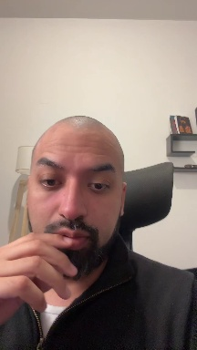
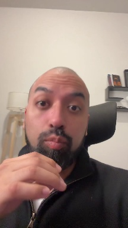
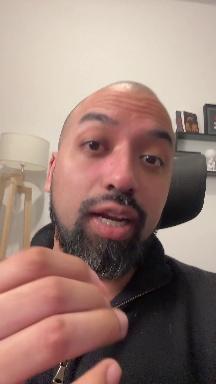

# Informe del clip

**Elegido:** 5.4–42.1 s (36.7 s) · puntaje **37**

> Porque la seguridad aparece en pequeñas acciones, y muchas de esas acciones ni siquiera somos conscientes que la hacemos. Por ejemplo, en las micro expresiones que hace tu cara cuando ve una mujer atractiva, al tono de voz cuando estás hablando con ella, y al trato que estás aceptando por ella. Volverte más atractivo no se trata de fingir un personaje, se trata de construir ese personaje. Y por personaje, me refiero a una persona segura de sí misma. Y para ser segura de sí misma, tenés que pasar situaciones que usualmente estás inseguro, como volar en público, hablar con mujeres atractivas, sentirte incómodo en tu piel.

**Por qué:** gancho +8, impacto +12, pausas +0, energia +9, relleno +0, estructura +0, duracion +3, cierre +5

**Lo disparó:** gancho «porque»; «segura» (30.7s); «segura» (32.5s); «inseguro,» (36.8s)

## Top 1 momentos (de 10 tramos evaluados)

| # | tramo | puntaje | gancho | impacto | pausas | energía | relleno | estructura | frases que lo dispararon |
|---|---|---|---|---|---|---|---|---|---|
| 1 ✅ | 5–42 s | 37 | 8 | 12 | 0 | 9 | 0 | 0 | gancho «porque»; «segura» (30.7s); «segura» (32.5s); «inseguro,» (36.8s) |

## Por qué se descartaron los otros

- No hubo otros tramos válidos.

## Palabras para revisar (confianza de Whisper < 50%)

- 7.7 s: «acciones,» (38%)
- 28.7 s: «personaje,» (48%)
- 30.7 s: «segura» (41%)
- 36.8 s: «inseguro,» (44%)
- 37.8 s: «volar» (27%)

## Gancho

| fórmula | texto | caracteres | elegida |
|---|---|---|---|
| A · afirmación contraria | NO SE TRATA DE FINGIR | 21 | ✅ |
| B · pregunta abierta | ¿QUÉ TE HACE MÁS ATRACTIVO? | 27 |  |
| C · imperativo | DEJÁ DE FINGIR UN PERSONAJE | 27 |  |

- En pantalla: 100 px, 2 líneas, y 276–512 (sobre los ojos), bajada de video 0 px.
- Cambiar de variante: `"gancho_variante": "B"` en `plan.override.json` y re-render. Previews: `preview-A/B/C.mp4`.

## Arranque y cuadro 0

- Voz plena a 0.26 s del corte → se recortó 0.210 s: la primera palabra empieza a **0.050 s**.

| # | t (s) | puntaje | notas | cumple ≤0.15 s |
|---|---|---|---|---|
|  1 | 0.00 | -1.16 | parpadeo, mano sobre la boca | — |
|  2 | 0.00 | -1.16 | parpadeo, mano sobre la boca | — |
|  3 | 0.00 | -1.16 | parpadeo, mano sobre la boca | — |
|  4 | 0.23 | 3.81 | mano sobre la boca | ✅ |
|  5 | 0.47 | 6.86 | ok | — |
|  6 | 0.71 | 6.79 | ok | — |

## Encuadre
- Video 1080x1920 → modo **cara**, cara en 100% de las muestras.

## Plan
- gancho 0–2.0 s: {"texto": "NO SE TRATA DE FINGIR", "clave": "FINGIR", "variante": "A"}
- pasos 6.61–15.6 s: {"titulo": "3 señales", "pasos": ["Las micro expresiones", "El tono de voz", "El trato"]}
- comparacion 18.01–20.61 s: {"mal": "Fingir un personaje", "bien": "Construir ese personaje"}
- enfasis 26.82–27.82 s: {"palabra": "Segura"}
- pasos 31.89–36.61 s: {"titulo": "3 retos", "pasos": ["Hablar en público", "Hablar con mujeres", "Sentirte incómodo"]}
- 0 jump cuts, 7 palabras clave

## QA
- Audio: -14.0 LUFS, true peak -1.5 dBTP ✅
- Solape con la cara: gancho/ojos 0% · gancho/boca 0% · subtítulos/boca-mentón 0% · íconos/cara 0% · tarjetas/ojos-boca 0% → metas ✅
- Íconos omitidos por no tener lugar fuera de la cara: 44%
- Sin sonido: cuadro 0 con el gancho completo ✅ · silencio inicial: ninguno · primer impacto de sonido a 0 s
- Tramos > 1.5 s sin evento: 0 · textos fuera de zona segura: 0
- ⚠ Gancho 100 px = 1.09x del subtítulo (meta ≥ 1.15x)
- Minutos de Actions de esta corrida: **12.1**
